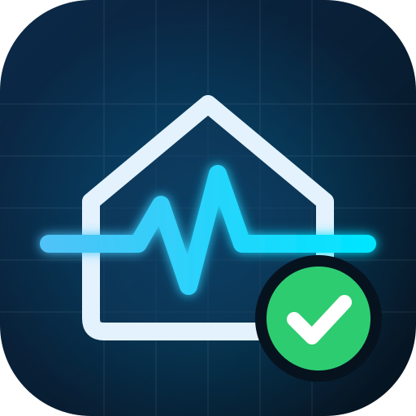

  

<h1 align="center">Dege's Home Assistant Diagnostics</h1>

  Plain-language health checks for your Home Assistant setup. 
  Read-only. A single HTML page that runs in your browser.

---

## What it checks

| Area | Checks |
| --- | --- |
| ⚙️ **System & Core** | Response time, safe/recovery mode, available updates, basic settings, system inventory |
| 🧩 **Integrations** | Integrations failing to load or needing re-login, disabled integrations |
| 🩺 **Repairs & Logs** | Open repairs, errors and warnings since the last restart |
| 💡 **Entities & Devices** | Unavailable entities, offline devices, low batteries, stale sensors, orphaned entities, unknown states, devices without an area, duplicate names |
| 🤖 **Automations & Scripts** | Broken automations, recent run errors, missing entities and actions, turned-off and never-triggered automations |
| 📊 **Dashboards** | Dashboards that fail to load, missing entities on cards, broken navigation buttons, missing custom cards and resources |
| 💾 **Database & Backups** | History recording, backup age, failed automatic backups, off-device copies |
| 🖥️ **Host & Apps** | Supervisor health, disk space, memory and CPU, internet connection, apps that should be running *(Home Assistant OS and Supervised)* |
| 🔒 **Users & Security** | Access level, administrator accounts, unused long-lived tokens, unencrypted remote access |

Every finding explains what it means and how to fix it, with an **Open ↗** link straight to the right page in Home Assistant.

## Features

- **Quick health check** of the most important items in about a minute, or run every check
- **Simple** view in plain language, or **Detailed** view with entity IDs, full lists, raw data and adjustable thresholds
- **Health score** and comparison with your previous run (new, worse and fixed)
- Export the report as Markdown or JSON, copy a summary, or print it
- **Demo mode** with sample data, so you can try it without connecting
- Light and dark mode

## Install

1. Copy `ha-diagnostics.html` into the `www` folder of your Home Assistant configuration (create the folder if it doesn't exist).
2. Restart Home Assistant if you just created the `www` folder.
3. Add it to the sidebar: **Settings → Dashboards → Add dashboard → Webpage**, and enter the URL `/local/ha-diagnostics.html`.

Opened from the sidebar, it uses your current Home Assistant login automatically. Use an **administrator** account to get a complete report.

### Run it from anywhere else

Open the file in a browser, then enter your Home Assistant address and a long-lived access token (**Profile → Security → Long-lived access tokens**). Add `?demo` to the URL to start straight in demo mode.

## Privacy

The page only reads from Home Assistant and never changes anything. Results and settings are stored in your browser and are not sent anywhere else.

## License

[MIT](LICENSE) © 2026 Degederon
